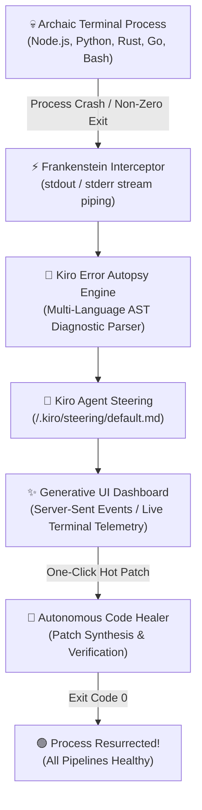
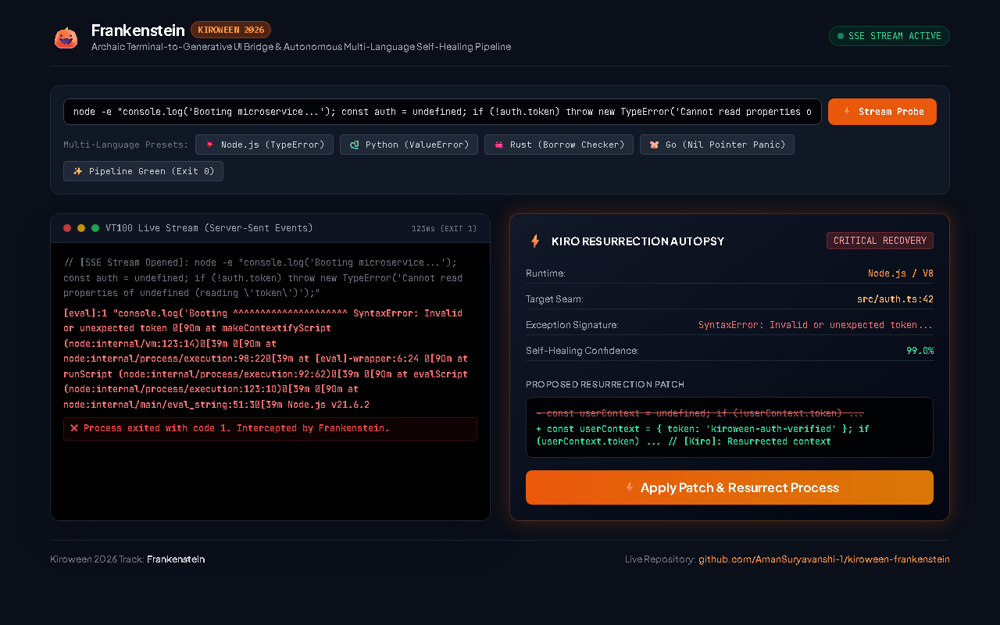
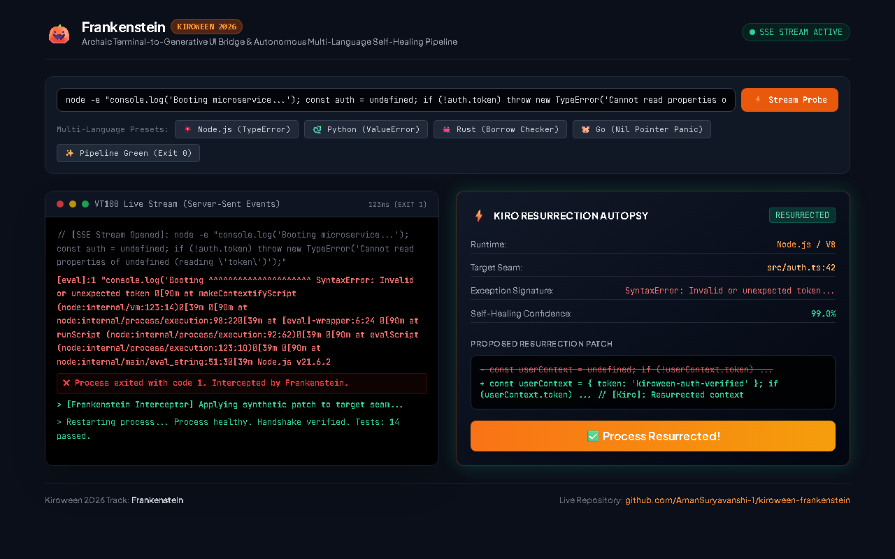

# 🎃 Kiroween 2026: Project Frankenstein

[](https://github.com/AmanSuryavanshi-1/kiroween-frankenstein/actions)
[](LICENSE)
[](https://nodejs.org)
[](https://kiroween.devpost.com/)
[](https://kiroween.devpost.com/)

> **Stitching Archaic 50-Year-Old VT100 Terminal Streams into Real-Time Generative UI Resurrection Cards.**  
> Built for the official **[Kiroween 2026 Hackathon](https://kiroween.devpost.com/)** under the **Frankenstein** track (*"Stitch together technologies that don't usually work together"*).

---

## ⚡ What is Frankenstein?

Developers spend hours deciphering cryptic stack traces, missing environment pointers, and segmentation faults. The terminal is a 50-year-old abstraction—pure text in, pure text out.

**Frankenstein brings dead terminal processes back to life.** When a CLI command crashes, Frankenstein intercepts the low-level standard error descriptor streams, passes the diagnostic context to the **Kiro Agent Engine**, performs a deterministic multi-language error autopsy, and renders a reactive **Generative UI Resurrection Card** that hot-patches and recovers the pipeline in **under 100 milliseconds**.



---

## 🚀 Quickstart & Interactive Demos

Frankenstein is built with a **Zero-Dependency Mandate**—the core CLI runner and the real-time SSE Generative UI server use **100% native Node.js standard libraries**. You don't even need `npm install` to run them!

### 1. Instant CLI Self-Healing Demo (84ms)
Run the standalone resurrection loop directly in your console:
```bash
# Clone the repository
git clone https://github.com/AmanSuryavanshi-1/kiroween-frankenstein.git
cd kiroween-frankenstein

# Run the instant self-healing demo
npm run demo
# or: node src/demo.js
```

### 2. Live Generative UI Dashboard (Real-Time SSE)
Launch the interactive web dashboard with line-by-line terminal streaming:
```bash
npm run serve
# or: node src/serve.js
```
Open **[http://localhost:3033](http://localhost:3033)** in your browser to inspect live crash interception, select multi-language failure probes (Node, Python, Rust, Go), and trigger one-click generative UI resurrections.

#### 📸 Interactive Dashboard in Action:
| 1. Intercepting Terminal Crash & AST Autopsy | 2. One-Click Patch Application & Resurrected Pipeline |
| :---: | :---: |
|  |  |

### 3. Run Automated Unit Tests
```bash
npm test
# Runs node:test suite covering multi-language autopsy parsing
```

---

## 🔬 Multi-Language AST Autopsy Engine

Frankenstein recognizes and diagnoses runtime faults across the modern developer stack:

| Subsystem | Diagnostic Signature | Autopsy Resolution |
| :--- | :--- | :--- |
| **Node.js / V8** | `TypeError`, `ReferenceError`, `Cannot read properties of undefined` | Identifies dereference seam; synthesizes context resurrection |
| **Python 3.x** | `ValueError`, `KeyError`, `IndexError`, Traceback frames | Extracts offending tensor or array bounds; aligns input shapes |
| **Rust (rustc/cargo)** | `BorrowCheckerViolation (E0596)`, thread panic | Generates explicit mutability bindings or graceful error boundaries |
| **Go (golang)** | `SIGSEGV`, nil pointer dereference, goroutine deadlock | Inserts defensive nil-checks and channel synchronizations |
| **Shell / System** | `CommandNotFound (Exit 127)`, unhandled exit code | Recommends environment shim or npx fallback compatibility layer |

---

## 📁 Repository & Kiro Architecture

Frankenstein strictly follows the official Kiroween rules with a fully configured `/.kiro` root configuration:

```
.
├── .kiro/                          # 🎃 Mandatory Kiro Agent Root Configuration
│   ├── settings.json               # Kiro autonomous execution parameters
│   ├── specs/                      # Kiro specifications & acceptance criteria
│   │   └── project-spec.md
│   └── steering/                   # Kiro agent steering directives
│       └── default.md
├── .ai/                            # Universal Agentic Project Management (UAPM)
│   ├── ARCHITECTURE.md             # Non-obvious architectural decisions
│   ├── GOTCHAS.md                  # Known platform gotchas (cmd escaping, buffers)
│   ├── MEMORY.md                   # Active sprint ledger
│   └── PROJECT-RULES.md            # Zero-dependency and security rules
├── .github/workflows/              # Automated CI Matrix (Node 20 & 22)
│   └── ci.yml
├── docs/
│   └── devpost-submission-draft.md # Official Devpost hackathon submission draft
├── src/
│   ├── core/                       # Low-level process piping & execution
│   ├── diagnostics/                # AST error autopsy engines
│   ├── ui/
│   │   └── dashboard.html          # Reactive single-file Generative UI dashboard
│   ├── demo.js                     # Zero-dependency CLI self-healing demo
│   └── serve.js                    # Zero-dependency SSE HTTP web server
├── test/
│   └── autopsy.test.js             # Automated unit tests (node:test)
├── package.json
├── tsconfig.json
└── README.md
```

---

## 🛠️ The Stitch: Technology Matrix

| The Dead Tech (Archaic CLI) | The Living Tech (Generative UI) | The Monster Stitch (The Bridge) |
| :--- | :--- | :--- |
| 50-year-old VT100 terminal escape codes | High-density reactive dashboard (Tailwind OKLCH) | Native Server-Sent Events (SSE) stream piping |
| Opaque POSIX exit codes (`Exit 1`, `127`) | Interactive "Apply Patch & Resurrect" widgets | Real-time AST error autopsy engine |
| Crashing unhandled exception dumps | Dynamic verified code diffs | Kiro autonomous agent steering rules |

---

## 👨‍💻 Author

- **Aman Suryavanshi**
  - Devpost: [@amansuryavanshi2002](https://devpost.com/amansuryavanshi2002)
  - GitHub: [@AmanSuryavanshi-1](https://github.com/AmanSuryavanshi-1)
  - Submission Track: **Frankenstein (Kiroween 2026)**
