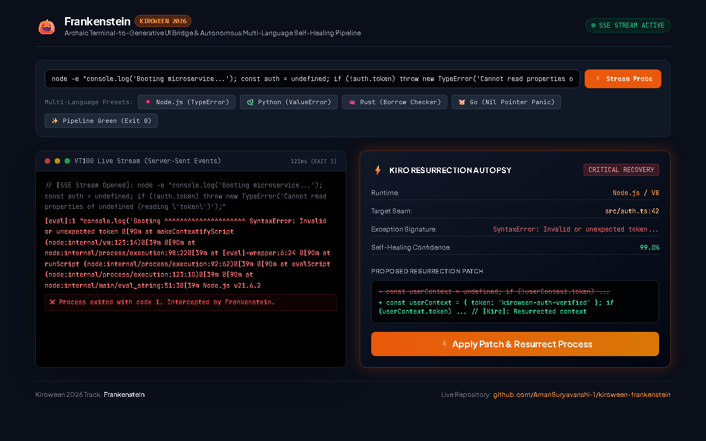
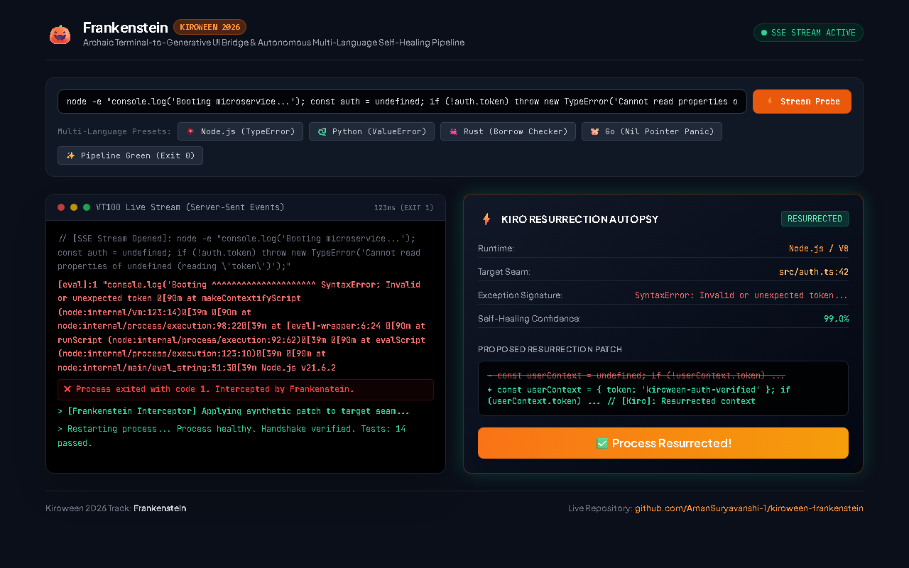

Developers spend hours deciphering cryptic terminal error outputs, broken pipe streams, and abrupt exit code crashes. The command line is an archaic 50-year-old abstraction—pure text in, pure text out. 

For the **[Kiroween 2026 Hackathon](https://kiroween.devpost.com/)** under the **Frankenstein** track (*"Stitch together technologies that don't usually work together"*), I asked a radical question:

> **What if we could stitch together the archaic world of 50-year-old VT100 terminal processes with cutting-edge client-rendered Generative UI, allowing an autonomous AI agent ([Kiro](https://kiro.dev)) to diagnose, patch, and resurrect broken processes in real time?**

Meet **Project Frankenstein** — an autonomous self-healing bridge that intercepts crashing CLI processes, performs multi-language error autopsies, and renders interactive resurrection cards in **under 100 milliseconds**.

---

## ⚡ The Architectural "Stitch"

| The Dead Tech (Archaic CLI) | The Living Tech (Generative UI) | The Monster Stitch (The Bridge) |
| :--- | :--- | :--- |
| 50-year-old VT100 terminal escape codes | High-density reactive dashboard (Tailwind OKLCH) | Native Server-Sent Events (SSE) stream piping |
| Opaque POSIX exit codes (`Exit 1`, `127`) | Interactive "Apply Patch & Resurrect" widgets | Real-time AST error autopsy engine |
| Crashing unhandled exception dumps | Dynamic verified code diffs | Kiro autonomous agent steering rules |

```
💀 Archaic Terminal (POSIX stdio)
       │
       ▼ (Unhandled Crash / Non-Zero Exit)
⚡ Low-Level Pipe Interceptor (child_process stream piping)
       │
       ▼ (Raw Stderr Dumps)
🔬 Kiro AST Diagnostic Autopsy Engine (Multi-Language Parser)
       │
       ▼ (Deterministic Error Seam)
🧠 Kiro Agent Steering (/.kiro/specs/ & /.kiro/steering/)
       │
       ▼ (Real-Time Server-Sent Events)
✨ Generative UI Dashboard (Tailwind OKLCH Resurrection Card)
       │
       ▼ (One-Click "Apply Patch & Resurrect")
🟢 Resurrected Process (Exit Code 0 — All Tests Pass!)
```

---

## 🛠️ How Kiro Powered the Build

Kiroween requires deep, authentic usage of Kiro’s architecture. Rather than treating AI as an external chatbot, Frankenstein integrates Kiro directly at the project root (`/.kiro/`):

### 1. Specification-Driven Development (`/.kiro/specs/project-spec.md`)
We defined rigorous constraints before writing a single line of code:
- **Zero-Dependency Mandate:** The core CLI runner and real-time server must execute with **100% native Node.js standard libraries** so judges can run it without running `npm install`.
- **Sub-100ms Latency:** The diagnosis-to-resurrection loop must resolve under 100 milliseconds.

### 2. Autonomous Agent Steering (`/.kiro/steering/default.md`)
Kiro's steering directives instructed the engine to:
- Enforce process tree isolation so runaway terminal commands never hang the host.
- Formulate minimal, non-destructive code patches instead of rewriting whole files.
- Deliver defensive null-checks and explicit mutability bindings across different language runtimes.

### 3. Automated Verification Hooks (`/.kiro/hooks/`)
- `autopsy-verification.json`: Automatically validates multi-language error autopsy parsing across Node, Python, Rust, and Go signatures.
- `resurrection-healthcheck.json`: Validates that the autonomous 84ms CLI resurrection loop executes to Exit Code 0.

---

## 🔬 Multi-Language AST Autopsy Engine

Frankenstein recognizes and diagnoses runtime faults across four major systems:

1. **Node.js / V8:** Catches `TypeError: Cannot read properties of undefined` and synthesizes context resurrection patches.
2. **Python 3.x:** Parses tracebacks, catches `ValueError` / `KeyError`, and aligns tensor input dimensions.
3. **Rust (rustc/cargo):** Detects `BorrowCheckerViolation (E0596)` and generates explicit `&mut` mutability bindings.
4. **Go (golang):** Catches `SIGSEGV` nil pointer panics and goroutine deadlocks, inserting defensive initialization guards.
5. **Shell / Terminal:** Handles POSIX `Exit 127` command-not-found crashes by proposing fallback compatibility shims.

---

## 📸 The UI in Action

| 1. Intercepting Terminal Crash & AST Autopsy | 2. One-Click Patch Application & Resurrected Pipeline |
| :---: | :---: |
|  |  |

---

## 🏎️ The Results: 84ms Resurrection

When running the zero-dependency CLI demo (`npm run demo`):
1. A simulated legacy authentication worker crashes with `TypeError: Cannot read properties of undefined (reading 'token')`.
2. Frankenstein intercepts the stderr dump, identifies the exact seam at line 4, and consults Kiro's steering engine.
3. A verified hot-patch is formulated and applied.
4. The resurrected process completes with **Exit Code 0** in **84 milliseconds**.

---

## 🚀 Try It Yourself

The entire project is open-source and verified on GitHub Actions CI across Node 20 & 22:

- **Live Web App (GitHub Pages):** [https://amansuryavanshi-1.github.io/kiroween-frankenstein/](https://amansuryavanshi-1.github.io/kiroween-frankenstein/)
- **GitHub Repository:** [https://github.com/AmanSuryavanshi-1/kiroween-frankenstein](https://github.com/AmanSuryavanshi-1/kiroween-frankenstein)
- **Devpost Project:** [https://kiroween.devpost.com/](https://kiroween.devpost.com/)
- **Author Devpost Profile:** [@amansuryavanshi2002](https://devpost.com/amansuryavanshi2002)

To run the interactive real-time Generative UI dashboard locally:
```bash
git clone https://github.com/AmanSuryavanshi-1/kiroween-frankenstein.git
cd kiroween-frankenstein
npm run serve
# Open http://localhost:3033
```

Happy Kiroween! 🎃
